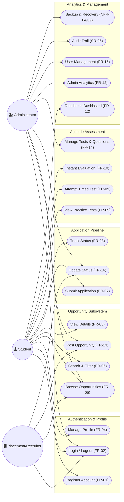
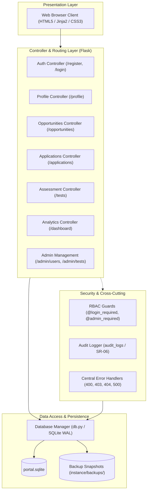
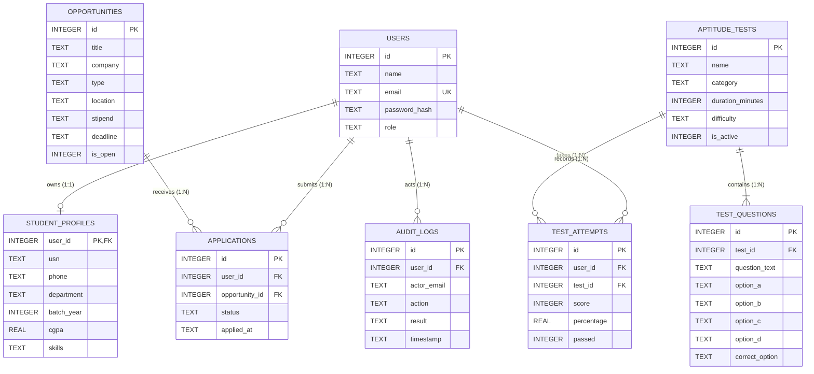

## Project Overview

The Online Internship & Placement Preparation Portal is a web-based
system designed to centralize internship and placement opportunity
discovery, applications, aptitude testing, preparation tracking,
and analytics.

## Team

Team H3
- Shriya K: PES1UG24CS448
- Srivani Karanth: PES1UG24CS471
- Sia Simran A: PES1UG24CS453

## Phase 1 Deliverables

- Software Requirements Specification
- Software Test Plan
- Test Case Specification
- Software Architecture & Design Specification

## Documentation

| Document | Description |
|---|---|
| 01_COMPLETE_SRS_IEEE_STYLE.docx | Complete SRS (IEEE format) |
| 02_COMPLETE_IEEE_TEST_PLAN.docx | IEEE-style Test Plan |
| 03_COMPLETE_TEST_CASES_15.docx | Baseline functional, NFR and security test cases |
| 04_COMPLETE_ARCHITECTURE_AND_DESIGN.docx | Architecture and Design Specification |
| [docs/UML_DIAGRAMS.md](docs/UML_DIAGRAMS.md) | Comprehensive UML Specifications (Use Case, Class, Sequence, Component, State & ER) |
| [docs/TEST_CASE_SPECIFICATION.md](docs/TEST_CASE_SPECIFICATION.md) | Updated Test Case Specification (TC-01 to TC-33 covering Sprints 1 & 2) |
| [docs/UNIT_TEST_REPORT.md](docs/UNIT_TEST_REPORT.md) | Unit Test Report (135/135 tests passing) |
| [docs/SYSTEM_VALIDATION_REPORT.md](docs/SYSTEM_VALIDATION_REPORT.md) | System Validation Report (100% requirements verified) |
| [docs/CODE_COVERAGE_REPORT.md](docs/CODE_COVERAGE_REPORT.md) | Code Coverage Report (91% statement coverage) |
| [docs/BRANCH_COVERAGE_REPORT.md](docs/BRANCH_COVERAGE_REPORT.md) | Branch Coverage Report (75% branch coverage) |
| [docs/SPRINT_3_REPORT.md](docs/SPRINT_3_REPORT.md) | Sprint 3 Quality Hardening & Part-3 Deliverables Report |

## UML Diagrams

> Full diagrams, detailed sequence flows, and traceability are documented in [docs/UML_DIAGRAMS.md](docs/UML_DIAGRAMS.md).

### 1. System Use Case Diagram

### 2. Layered Component Architecture Diagram

### 3. Entity-Relationship (ER) Diagram

## Sprint 1 Backlog Status: Closed

All Sprint 1 / Iteration 1 user stories, functional modules, and test suites have been implemented, merged, and verified.

- **Web Application**: [`placement-portal/`](placement-portal/) (Flask + SQLite)
- **Test Suite**: 91 unit and integration tests passing (`python -m pytest tests -v`)
- **Key Deliverables Completed**:
  - **Task #6**: User Registration & PBKDF2 Password Hashing (`FR-01`, `SR-02`, `SR-05`, `TC-01`)
  - **Task #7**: User Authentication (Login/Logout & Session Guard) (`FR-02`, `TC-02`)
  - **Task #9**: Student Academic Profile Management (`FR-04`)
  - **Tasks #11 & #12**: Opportunity Catalog, Keyword Search & Location Filtering (`FR-05`, `FR-06`, `TC-04`, `NFR-03`)
  - **Task #13**: Opportunity Details View (`FR-05`)
  - **Task #15**: Application Submission & Application Status Tracking (`FR-07`, `FR-08`, `FR-16`, `TC-05`, `TC-06`)
  - **Task #16**: Practice Aptitude Tests Listing (`FR-09`)
  - **Task #18**: Interactive Aptitude Testing, Automated Scoring & Scorecard Review (`FR-09`, `FR-10`, `TC-07`)
  - **Task #30**: Query Optimization, Indexing & Performance Benchmarks (`NFR-01`, `NFR-06`, `TC-09`)

