# Team H3 — Software Architecture & UML Specifications
## Online Internship & Placement Preparation Portal

This document contains the complete unified Modeling Language (UML) specifications for the **Online Internship & Placement Preparation Portal**, tracing architectural components directly to the Software Requirements Specification (SRS), IEEE Test Plan, and the database schema.

---

## Table of Contents
1. [System Use Case Diagram](#1-system-use-case-diagram)
2. [Domain Class Diagram](#2-domain-class-diagram)
3. [System Sequence Diagrams](#3-system-sequence-diagrams)
   - [3.1 Authentication & Opportunity Discovery](#31-sequence-diagram-authentication--opportunity-discovery-fr-01-fr-02-fr-05-fr-06)
   - [3.2 Application Submission & Status Tracking](#32-sequence-diagram-application-submission--status-tracking-fr-07-fr-08-fr-16)
   - [3.3 Aptitude Assessment & Automated Scoring](#33-sequence-diagram-aptitude-assessment--automated-evaluation-fr-09-fr-10)
   - [3.4 Admin Aptitude Test & Question Bank Management](#34-sequence-diagram-admin-aptitude-test-management-fr-14--issue-27)
   - [3.5 Admin User Management & Audit Logging](#35-sequence-diagram-admin-user-management--audit-logging-fr-15-sr-06--issue-25)
4. [Component & Layered Architecture Diagram](#4-component--layered-architecture-diagram)
5. [State Transition Diagrams](#5-state-transition-diagrams)
   - [5.1 Application Lifecycle State Machine](#51-application-lifecycle-state-machine)
   - [5.2 Aptitude Assessment State Machine](#52-aptitude-assessment-state-machine)
6. [Entity-Relationship (ER) Diagram](#6-entity-relationship-er-diagram)
7. [Requirements Traceability Matrix](#7-requirements-traceability-matrix)

---

## 1. System Use Case Diagram

The use case diagram outlines interactions between actors (**Student**, **Recruiter**, and **Admin**) and the portal's core functional capabilities.

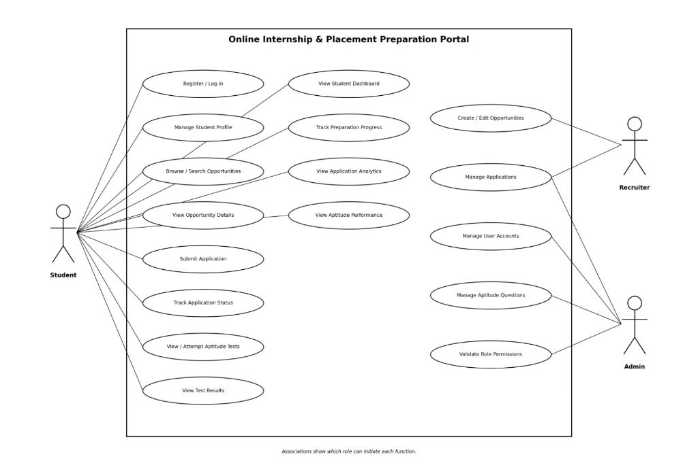

*Direct image files:*
* [docs/images/use_case_diagram.png](images/use_case_diagram.png)
* [docs/images/use_case_diagram.jpg](images/use_case_diagram.jpg)

### Interactive System Use Case Model

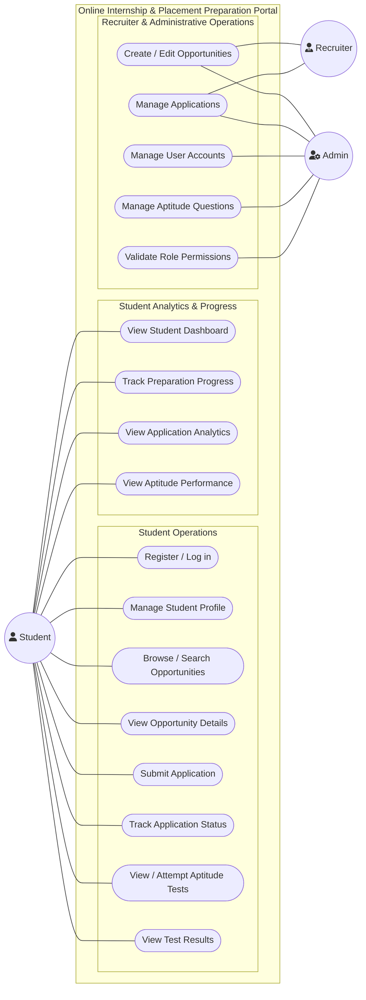

*Note: Associations show which role can initiate each function.*

---

## 2. Domain Class Diagram

The class diagram models the structural domain entities, their primary attributes and operations, along with associations and multiplicities.

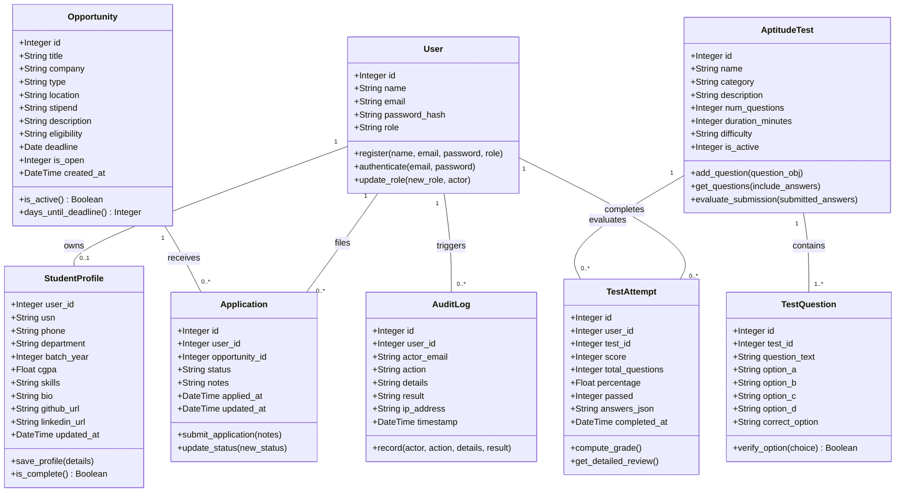

---

## 3. System Sequence Diagrams

### 3.1 Sequence Diagram: Authentication & Opportunity Discovery (FR-01, FR-02, FR-05, FR-06)

Illustrates secure login, password hash verification, session setup, and opportunity catalog querying with multi-criteria filters.

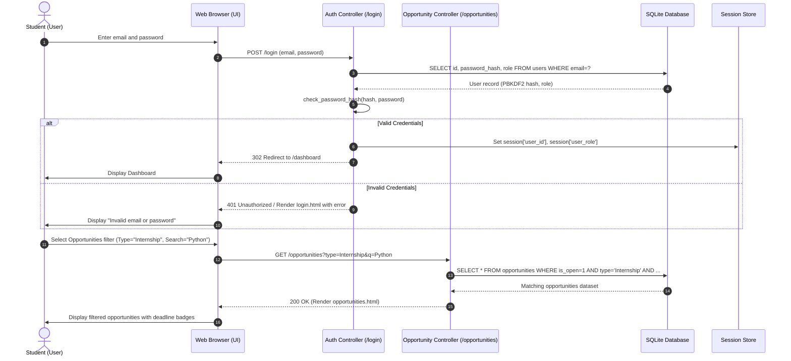

---

### 3.2 Sequence Diagram: Application Submission & Status Tracking (FR-07, FR-08, FR-16)

Demonstrates how duplicate applications are rejected via database constraints and how status updates propagate to the student's tracker.

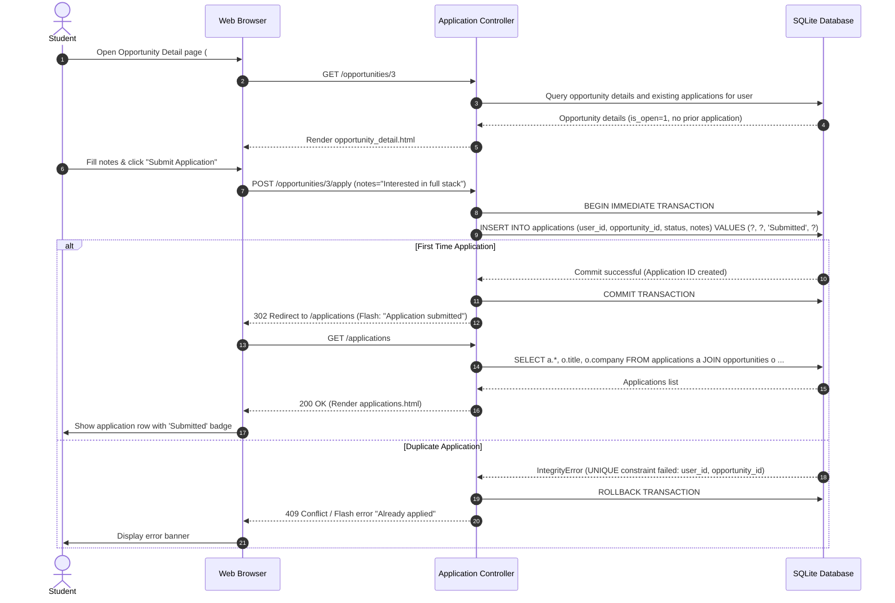

---

### 3.3 Sequence Diagram: Aptitude Assessment & Automated Evaluation (FR-09, FR-10)

Validates that students never receive answer keys client-side and demonstrates instant server-side grading.

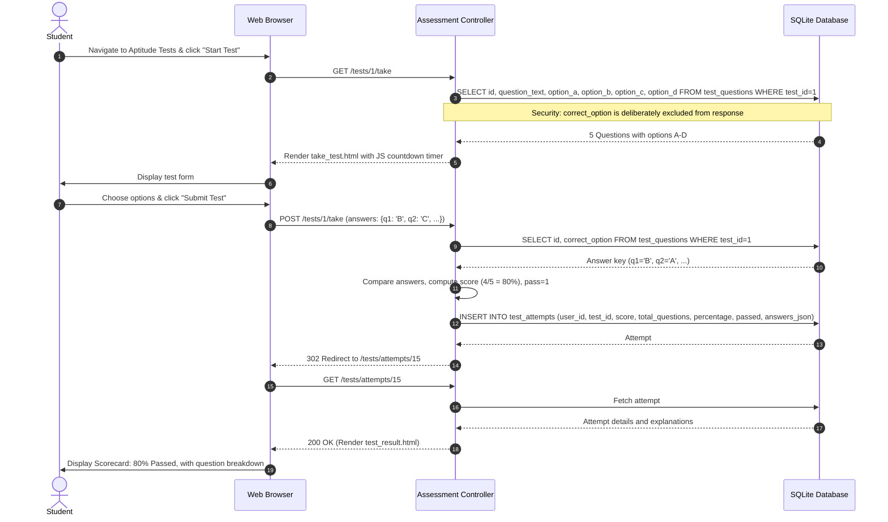

---

### 3.4 Sequence Diagram: Admin Aptitude Test Management (FR-14 / Issue #27)

Outlines role-based test creation, question addition, input validation, and transactional persistence.

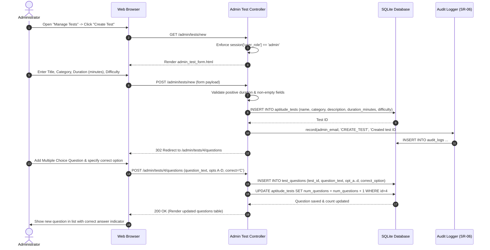

---

### 3.5 Sequence Diagram: Admin User Management & Audit Logging (FR-15, SR-06 / Issue #25)

Shows administrator role modifications, self-lockout prevention, and immutable security audit logging.

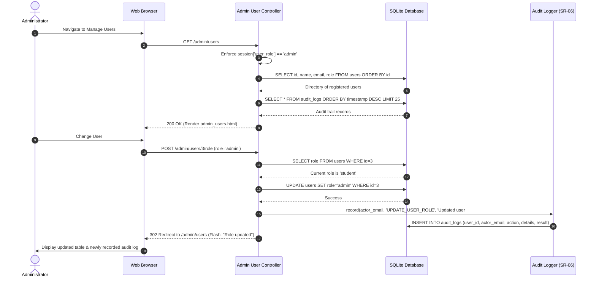

---

## 4. Component & Layered Architecture Diagram

Illustrates the high-cohesion, low-coupling tiered architecture conforming to the Software Architecture and Design Specification.

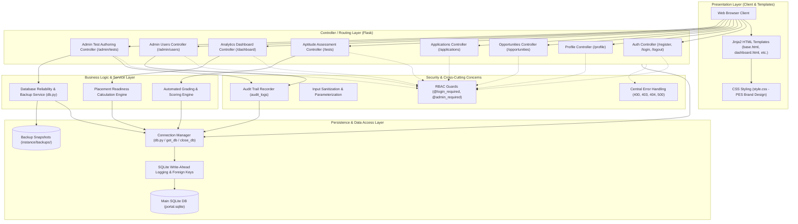

---

## 5. State Transition Diagrams

### 5.1 Application Lifecycle State Machine

Traces the states of an opportunity application from submission through final disposition.

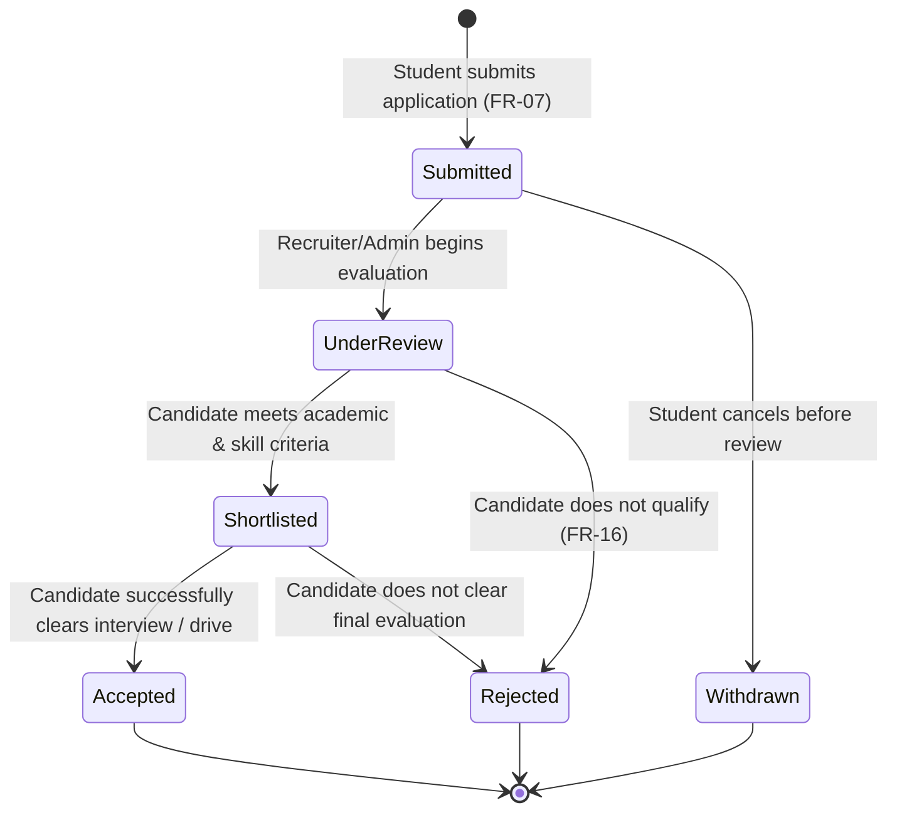

---

### 5.2 Aptitude Assessment State Machine

Traces the state of an aptitude test attempt.

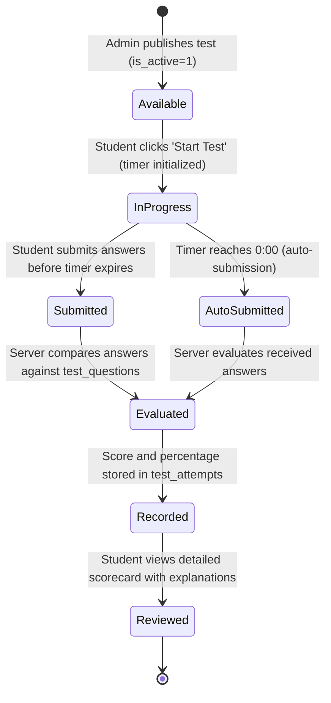

---

## 6. Entity-Relationship (ER) Diagram

Represents the physical SQLite relational schema, primary keys, foreign key constraints, cascade rules, and column data types.

```mermaid
erDiagram
    USERS ||--o| STUDENT_PROFILES : "owns (1:1)"
    USERS ||--o{ APPLICATIONS : "submits (1:N)"
    USERS ||--o{ TEST_ATTEMPTS : "takes (1:N)"
    USERS ||--o{ AUDIT_LOGS : "acts (1:N)"
    OPPORTUNITIES ||--o{ APPLICATIONS : "receives (1:N)"
    APTITUDE_TESTS ||--|{ TEST_QUESTIONS : "contains (1:N)"
    APTITUDE_TESTS ||--o{ TEST_ATTEMPTS : "records (1:N)"

    USERS {
        INTEGER id PK "AUTOINCREMENT"
        TEXT name "NOT NULL"
        TEXT email UK "NOT NULL, UNIQUE"
        TEXT password_hash "NOT NULL (PBKDF2-SHA256)"
        TEXT role "student | admin"
    }

    STUDENT_PROFILES {
        INTEGER user_id PK, FK "REFERENCES users(id) ON DELETE CASCADE"
        TEXT usn "University Serial Number"
        TEXT phone "Contact Number"
        TEXT department "Branch / Major"
        INTEGER batch_year "Graduation Year"
        REAL cgpa "0.0 to 10.0 scale"
        TEXT skills "Comma-separated list"
        TEXT bio "Student summary"
        TEXT github_url "Portfolio link"
        TEXT linkedin_url "Professional profile"
        TEXT updated_at "ISO-8601 Timestamp"
    }

    OPPORTUNITIES {
        INTEGER id PK "AUTOINCREMENT"
        TEXT title "NOT NULL"
        TEXT company "NOT NULL"
        TEXT type "Internship | Placement"
        TEXT location "NOT NULL"
        TEXT stipend "Human readable (e.g., Rs 25,000/mo)"
        TEXT description "Detailed JD"
        TEXT eligibility "CGPA and branch criteria"
        TEXT deadline "ISO Date (YYYY-MM-DD)"
        INTEGER is_open "0=Closed, 1=Open"
        TEXT created_at "ISO-8601 Timestamp"
    }

    APPLICATIONS {
        INTEGER id PK "AUTOINCREMENT"
        INTEGER user_id FK "REFERENCES users(id) ON DELETE CASCADE"
        INTEGER opportunity_id FK "REFERENCES opportunities(id) ON DELETE CASCADE"
        TEXT status "Submitted | Under Review | Shortlisted | Accepted | Rejected"
        TEXT notes "Statement of interest"
        TEXT applied_at "ISO-8601 Timestamp"
        TEXT updated_at "ISO-8601 Timestamp"
    }

    APTITUDE_TESTS {
        INTEGER id PK "AUTOINCREMENT"
        TEXT name "NOT NULL"
        TEXT category "Quantitative | Verbal | Logical | Technical"
        TEXT description "Test scope and syllabus"
        INTEGER num_questions "Total question count"
        INTEGER duration_minutes "Time limit"
        TEXT difficulty "Easy | Medium | Hard"
        INTEGER is_active "0=Inactive, 1=Active"
    }

    TEST_QUESTIONS {
        INTEGER id PK "AUTOINCREMENT"
        INTEGER test_id FK "REFERENCES aptitude_tests(id) ON DELETE CASCADE"
        TEXT question_text "NOT NULL"
        TEXT option_a "NOT NULL"
        TEXT option_b "NOT NULL"
        TEXT option_c "NOT NULL"
        TEXT option_d "NOT NULL"
        TEXT correct_option "A | B | C | D"
    }

    TEST_ATTEMPTS {
        INTEGER id PK "AUTOINCREMENT"
        INTEGER user_id FK "REFERENCES users(id) ON DELETE CASCADE"
        INTEGER test_id FK "REFERENCES aptitude_tests(id) ON DELETE CASCADE"
        INTEGER score "Correct answer count"
        INTEGER total_questions "Total questions asked"
        REAL percentage "Score percentage"
        INTEGER passed "0=Failed, 1=Passed"
        TEXT answers_json "Serialized student submissions"
        TEXT completed_at "ISO-8601 Timestamp"
    }

    AUDIT_LOGS {
        INTEGER id PK "AUTOINCREMENT"
        INTEGER user_id FK "REFERENCES users(id) ON DELETE SET NULL"
        TEXT actor_email "NOT NULL"
        TEXT action "NOT NULL (e.g. UPDATE_USER_ROLE)"
        TEXT details "Human-readable context"
        TEXT result "SUCCESS | FAILURE"
        TEXT ip_address "Client IP address"
        TEXT timestamp "ISO-8601 Timestamp"
    }
```

---

## 7. Requirements Traceability Matrix

| Requirement ID | Module / Subsystem | UML Design Artefact | Verification / Test Case |
|---|---|---|---|
| **FR-01** | User Registration | Use Case, Sequence 3.1, Class Diagram | `tests/test_registration.py` (`TC-01`) |
| **FR-02** | User Authentication | Use Case, Sequence 3.1, Component Diagram | `tests/test_auth.py` (`TC-02`) |
| **FR-03** | Role-Based Access Control | Component Diagram, Class Diagram | `tests/test_auth.py` (`TC-03`) |
| **FR-04** | Student Profile Management | Use Case, Class Diagram, ER Diagram | `tests/test_profile.py` |
| **FR-05** | Opportunity Browsing & Details | Use Case, Sequence 3.1, ER Diagram | `tests/test_opportunities.py` |
| **FR-06** | Opportunity Search & Filtering | Use Case, Sequence 3.1, Component Diagram | `tests/test_search_filter.py` (`TC-04`) |
| **FR-07** | Application Submission | Use Case, Sequence 3.2, State Machine 5.1 | `tests/test_applications.py` (`TC-05`) |
| **FR-08** | Application Status Tracking | Use Case, Sequence 3.2, State Machine 5.1 | `tests/test_applications.py` (`TC-06`) |
| **FR-09** | Aptitude Test Catalog & Taking | Use Case, Sequence 3.3, State Machine 5.2 | `tests/test_aptitude_tests.py` |
| **FR-10** | Automated Score Evaluation | Sequence 3.3, Class Diagram, ER Diagram | `tests/test_test_results.py` (`TC-07`) |
| **FR-12** | Analytics Dashboards | Use Case, Component Diagram | `tests/test_dashboard.py` (`TC-08`) |
| **FR-14** | Aptitude Test Management | Use Case, Sequence 3.4, Class Diagram | `tests/test_admin_aptitude_tests.py` |
| **FR-15** | User Directory & Role Management | Use Case, Sequence 3.5, Class Diagram | `tests/test_admin_users.py` (`TC-14`) |
| **FR-16** | Application Status Modification | Use Case, Sequence 3.2, State Machine 5.1 | `tests/test_applications.py` |
| **SR-02** | Credential Hashing (PBKDF2) | Class Diagram (`User.password_hash`) | `tests/test_auth.py` (`TC-13`) |
| **SR-06** | Administrative Audit Trail | Sequence 3.4, Sequence 3.5, ER Diagram | `tests/test_admin_users.py` (`TC-14`) |
| **NFR-04/09** | Reliability, Integrity & Recovery | Component Diagram, Sequence 3.4 | `tests/test_reliability_recovery.py` |
